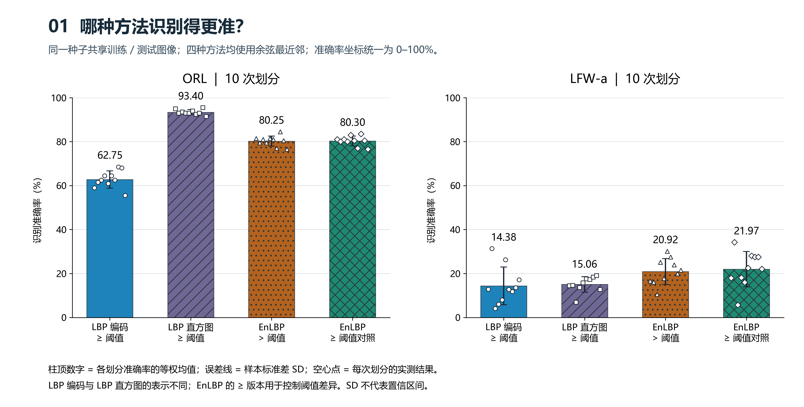
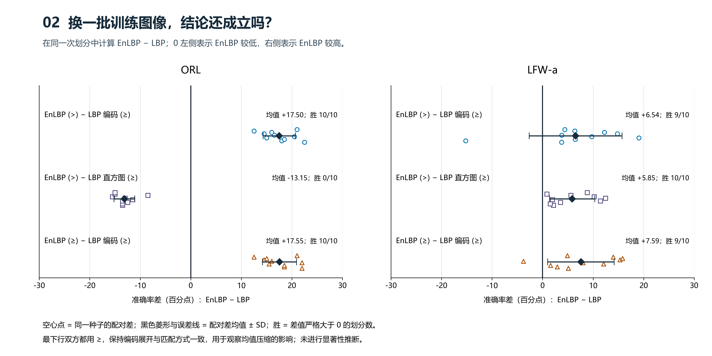
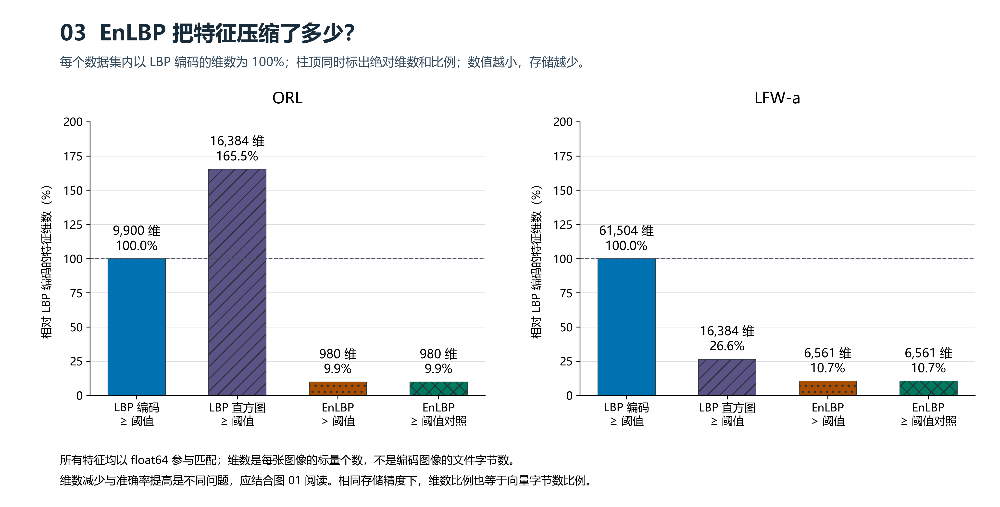
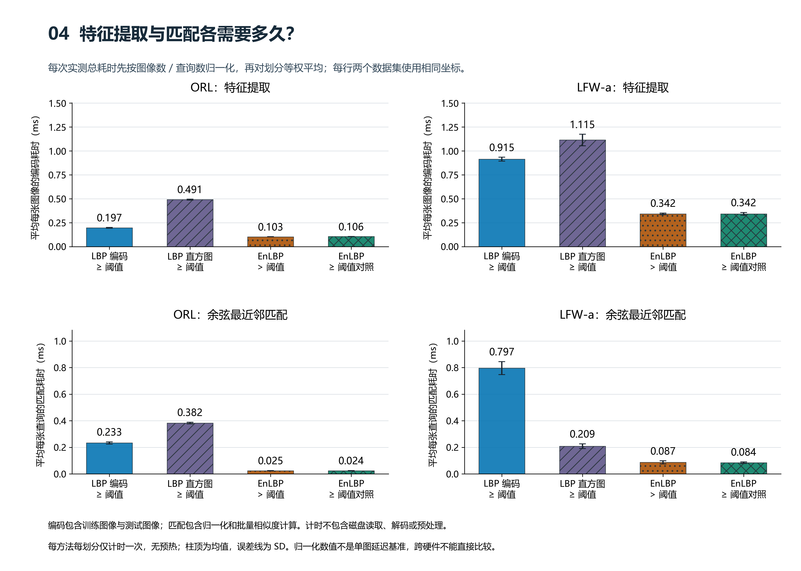
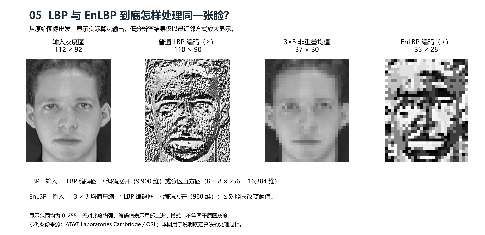

# LBP 与 EnLBP 对比实验参考图

本报告使用独立重建程序的真实实验结果；不是论文作者代码的原始结果。

## 实验设置

四种方法共享同一种子的训练与测试图像，使用余弦最近邻和原始图像尺寸。普通 LBP 使用 ≥；EnLBP 分别使用 > 和 ≥。后者是保持比较阈值一致的控制组。

- LBP 编码：8 邻域、valid、逐像素编码后展开。
- LBP 直方图：同一 LBP 编码，8×8 分区，每区 256 bins，L1 归一化并拼接。
- EnLBP：非重叠 3×3 块取均值，然后一层 dense LBP，编码展开。

原文存在流程与阈值歧义；这些是公开假设下的重建。对比 EnLBP(≥) 与 LBP 编码(≥)，可以保持表示和阈值一致，观察均值压缩的影响。对比 LBP 直方图时，表示方式也发生了变化。

### ORL

10 次固定种子划分：[0, 1, 2, 3, 4, 5, 6, 7, 8, 9]。每人 5 张训练；每次 40 人、200 张训练图像。测试数范围 200–200。图片尺寸（高×宽）：112×92。

| 方法 | 准确率（%）均值±SD | 人均准确率（%）均值±SD | 维数 | 编码（ms/图）均值±SD | 匹配（ms/查询）均值±SD |
|---|---:|---:|---:|---:|---:|
| LBP 编码 ≥ 阈值 | 62.75 ± 3.92 | 62.75 ± 3.92 | 9,900 | 0.197 ± 0.004 | 0.233 ± 0.008 |
| LBP 直方图 ≥ 阈值 | 93.40 ± 1.17 | 93.40 ± 1.17 | 16,384 | 0.491 ± 0.005 | 0.382 ± 0.006 |
| EnLBP > 阈值 | 80.25 ± 2.31 | 80.25 ± 2.31 | 980 | 0.103 ± 0.001 | 0.025 ± 0.002 |
| EnLBP ≥ 阈值对照 | 80.30 ± 2.21 | 80.30 ± 2.21 | 980 | 0.106 ± 0.002 | 0.024 ± 0.001 |

配对差异：

- EnLBP (>) − LBP 编码 (≥)：平均 +17.50 个百分点，SD = 3.18；胜 / 平 / 负 = 10 / 0 / 0。
- EnLBP (>) − LBP 直方图 (≥)：平均 -13.15 个百分点，SD = 2.04；胜 / 平 / 负 = 0 / 0 / 10。
- EnLBP (≥) − LBP 编码 (≥)：平均 +17.55 个百分点，SD = 3.35；胜 / 平 / 负 = 10 / 0 / 0。

### LFW-a

10 次固定种子划分：[0, 1, 2, 3, 4, 5, 6, 7, 8, 9]。每人 5 张训练；每次 14 人、70 张训练图像。测试数范围 196–795。图片尺寸（高×宽）：250×250。

| 方法 | 准确率（%）均值±SD | 人均准确率（%）均值±SD | 维数 | 编码（ms/图）均值±SD | 匹配（ms/查询）均值±SD |
|---|---:|---:|---:|---:|---:|
| LBP 编码 ≥ 阈值 | 14.38 ± 8.60 | 15.20 ± 3.98 | 61,504 | 0.915 ± 0.021 | 0.797 ± 0.049 |
| LBP 直方图 ≥ 阈值 | 15.06 ± 3.54 | 17.64 ± 3.48 | 16,384 | 1.115 ± 0.060 | 0.209 ± 0.018 |
| EnLBP > 阈值 | 20.92 ± 5.92 | 23.90 ± 3.54 | 6,561 | 0.342 ± 0.008 | 0.087 ± 0.012 |
| EnLBP ≥ 阈值对照 | 21.97 ± 8.04 | 22.34 ± 3.71 | 6,561 | 0.342 ± 0.014 | 0.084 ± 0.006 |

配对差异：

- EnLBP (>) − LBP 编码 (≥)：平均 +6.54 个百分点，SD = 9.19；胜 / 平 / 负 = 9 / 0 / 1。
- EnLBP (>) − LBP 直方图 (≥)：平均 +5.85 个百分点，SD = 4.48；胜 / 平 / 负 = 10 / 0 / 0。
- EnLBP (≥) − LBP 编码 (≥)：平均 +7.59 个百分点，SD = 6.58；胜 / 平 / 负 = 9 / 0 / 1。

## 如何解释

ORL：LBP 编码 ≥ 阈值 62.75%，LBP 直方图 ≥ 阈值 93.40%，EnLBP > 阈值 80.25%，EnLBP ≥ 阈值对照 80.30%；LFW-a：LBP 编码 ≥ 阈值 14.38%，LBP 直方图 ≥ 阈值 15.06%，EnLBP > 阈值 20.92%，EnLBP ≥ 阈值对照 21.97%。

- ORL：EnLBP(>) 相比 LBP 编码 的平均准确率差为 +17.50 个百分点，10 次中胜 10 次、负 0 次。
- ORL：EnLBP(>) 相比 LBP 直方图 的平均准确率差为 -13.15 个百分点，10 次中胜 0 次、负 10 次。
- ORL：EnLBP 保留 LBP 编码 9.90% 的维数。准确率、维数和耗时应一起比较；不能仅凭一项指标概括成 EnLBP 全面优于 LBP。
- LFW-a：EnLBP(>) 相比 LBP 编码 的平均准确率差为 +6.54 个百分点，10 次中胜 9 次、负 1 次。
- LFW-a：EnLBP(>) 相比 LBP 直方图 的平均准确率差为 +5.85 个百分点，10 次中胜 10 次、负 0 次。
- LFW-a：EnLBP 保留 LBP 编码 10.67% 的维数。准确率、维数和耗时应一起比较；不能仅凭一项指标概括成 EnLBP 全面优于 LBP。
- 图 02 下行保持双方 ≥ 和编码展开一致；两种 EnLBP 阈值版本均完整保留，没有选择有利结果后隐藏另一组。

均值按种子等权计算；误差线是划分之间的样本 SD（ddof=1），不是标准误或置信区间。划分共享图像，不能当作十组独立数据；未做显著性检验。LFW-a 每次身份集合与测试数量可能改变，提供了人均准确率避免只看多图身份占主导的总准确率。

编码 ms/图 = 每次编码总秒数 ×1000 /（训练数+测试数）；匹配 ms/查询 = 每次匹配总秒数 ×1000 / 测试数，然后对种子取等权均值。匹配使用批量计算，数值不是独立单图延迟。时间只测一次且无预热，依赖本机、线程数、实现与图库大小；不用于验证论文计时。

## 图与原始数据

### 01_accuracy

ORL：LBP 编码 ≥ 阈值 62.75%，LBP 直方图 ≥ 阈值 93.40%，EnLBP > 阈值 80.25%，EnLBP ≥ 阈值对照 80.30%；LFW-a：LBP 编码 ≥ 阈值 14.38%，LBP 直方图 ≥ 阈值 15.06%，EnLBP > 阈值 20.92%，EnLBP ≥ 阈值对照 21.97%。误差线为划分间 SD，空心点显示全部划分。

[PNG](01_accuracy.png) · [SVG](01_accuracy.svg)

### 02_paired_difference

配对差值图完整显示三个比较的全部划分；正值表示 EnLBP 准确率较高，负值表示较低，图中标有差值均值和获胜划分数。下行保持双方 ≥ 阈值一致。

[PNG](02_paired_difference.png) · [SVG](02_paired_difference.svg)

### 03_feature_dimension

特征维数以 LBP 编码为百分比基准，标有绝对维数。ORL 的 LBP 编码 9,900 维，EnLBP 980 维；LFW-a 的 LBP 编码 61,504 维，EnLBP 6,561 维。

[PNG](03_feature_dimension.png) · [SVG](03_feature_dimension.svg)

### 04_timing

两行分别显示每张图像平均编码耗时和每张查询平均匹配耗时，均为总耗时归一化后的均值与 SD。每方法每划分仅计时一次、无预热；结果依赖机器和批量大小。

[PNG](04_timing.png) · [SVG](04_timing.svg)

### 05_encoding_process

同一示例图像的原图、普通 LBP 编码、均值压缩和 EnLBP 编码，并解释编码展开与直方图表示。所有图像使用相同 0–255 显示范围，无对比度调整。

[PNG](05_encoding_process.png) · [SVG](05_encoding_process.svg)

[汇总表](comparison_summary.csv) · [逐种子数据](comparison_seed_results.csv) · [配对差](paired_differences.csv) · [图源与哈希](figure_manifest.json)

## 可视化方法来源

图形设计采用 Scientific Agent Skills 的科学可视化流程：Kassis, T., Agarwal, V., He, Y., Patel, D., & Brueckner, A. M. (2026). *Scientific Agent Skills: A Library of Procedural Knowledge for Research Agents*. [arXiv:2609.00065](https://doi.org/10.48550/arXiv.2609.00065)。它是可视化方法来源，不是 EnLBP 算法来源。
