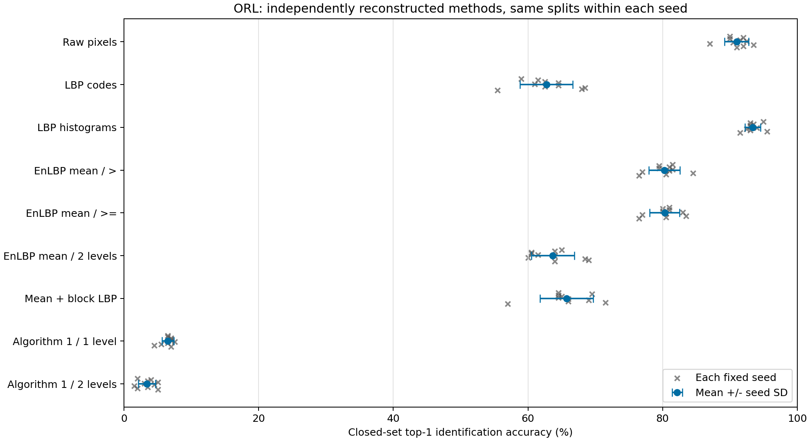
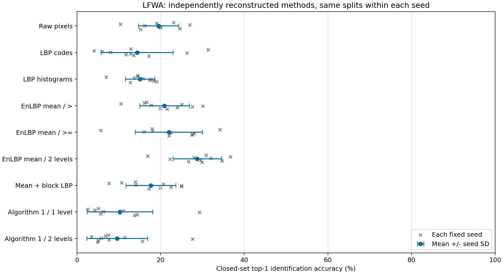
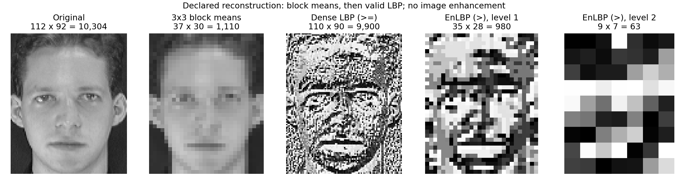

# EnLBP 实验结果与复现边界

运行日期：2026-10-13（Asia/Shanghai）。本报告的实测值均来自 `outputs/orl/` 和 `outputs/lfwa/` 的 JSON、CSV。代码重建了论文方法的多个解释，**没有恢复作者原代码，也没有复现到原文报告的准确率**。

## 1. 核心结果

默认实现是先取非重叠 3×3 均值，再做 dense valid LBP，严格 `>`，一层，编码图按行展开，使用余弦最近邻。十次固定种子的 ORL 准确率为 **80.25% ± 2.31 个百分点**；LFW-a 为 **20.92% ± 5.92 个百分点**。± 是这些随机划分的样本标准差，不是置信区间。

| 数据集 | 本次默认 EnLBP 均值（%） | 论文报告（%） | 能否确认同一实验？ |
|---|---:|---:|---|
| ORL | 80.25 | 99.07 | 不能：作者未给随机划分、次数和完整实现细节 |
| LFW-a | 20.92 | 61.428 | 不能：作者身份子集与测试分母未知 |

原报告值来自用户提供的论文第 4–5 页、印刷页 99–100。上表只呈现差距，不把两种未确认相同的协议当作严格性能排名。没有针对论文目标分数筛选 seed 或调整参数。

## 2. 已实际运行的协议

- ORL：40 人×10 张，共 400 张，原始 112×92；每人随机取 5 张训练、5 张测试，每次 200/200。
- LFW-a：作者页面下载的 13,233 张、5,749 人，原始 250×250；其中 143 人拥有至少 11 张图片。每个 seed 随机选 14 人，再每人取 5 张训练，剩余全部测试。图库固定 70 张，本次测试数从 196 到 795 张。
- 固定种子 0–9，NumPy `default_rng` / PCG64，无放回抽样。每个 seed 的 9 种方法使用相同图片划分；不同 seed 的图片与身份可能重叠。
- 仅做 Pillow 灰度读取，不缩放、直方图均衡化、裁脸或重新对齐。保留原始图像，池化只丢弃底部和右侧不完整块；LBP 使用 valid 邻域。
- 所有方法使用余弦相似度最大者的身份；零向量相似度设为 0，同分取图库第一张。这里是封闭集识别，分数不是概率。

LFW-a 沿用原数据目录标签，不使用普通 LFW、funneled、deep-funneled 或 scikit-learn 内置 LFW 作为替代。这是依据原文文字重建的身份识别实验，不是 LFW 的标准配对验证协议。

## 3. ORL 全部测量结果

| 方法 | Top-1 准确率均值 ± SD（%） | 每人准确率等权均值（%） | 维数 |
|---|---:|---:|---:|
| 原始灰度像素 | 91.00 ± 1.80 | 91.00 | 10304 |
| 普通 LBP 编码展开 | 62.75 ± 3.92 | 62.75 | 9900 |
| 普通 LBP 分区直方图 | 93.40 ± 1.17 | 93.40 | 16384 |
| EnLBP 均值后编码，严格 >，一层（默认） | 80.25 ± 2.31 | 80.25 | 980 |
| EnLBP 均值后编码，>=，一层 | 80.30 ± 2.21 | 80.30 | 980 |
| EnLBP 均值后编码，严格 >，两层 | 63.70 ± 3.20 | 63.70 | 63 |
| 均值后非重叠编码，一层 | 65.75 ± 3.94 | 65.75 | 120 |
| Algorithm 1 流程解释，一层 | 6.50 ± 0.88 | 6.50 | 1080 |
| Algorithm 1 流程解释，两层 | 3.40 ± 1.26 | 3.40 | 120 |

各 seed 测试数量相同、每人测试数量相同，所以这里图像准确率与每人等权准确率一致。默认 EnLBP 的向量从 10,304 个原像素缩为 980 个编码元素；普通 LBP 分区直方图基线在本次配置下为 93.40%，高于默认 EnLBP。这里的普通 LBP 配置也是本项目明确选择，不能视为原文 LBP 基线的精确复现。

## 4. LFW-a 全部测量结果

| 方法 | Top-1 准确率均值 ± SD（%） | 每人准确率等权均值（%） | 维数 |
|---|---:|---:|---:|
| 原始灰度像素 | 19.47 ± 4.80 | 21.59 | 62500 |
| 普通 LBP 编码展开 | 14.38 ± 8.60 | 15.20 | 61504 |
| 普通 LBP 分区直方图 | 15.06 ± 3.54 | 17.64 | 16384 |
| EnLBP 均值后编码，严格 >，一层（默认） | 20.92 ± 5.92 | 23.90 | 6561 |
| EnLBP 均值后编码，>=，一层 | 21.97 ± 8.04 | 22.34 | 6561 |
| EnLBP 均值后编码，严格 >，两层 | 28.75 ± 5.82 | 29.63 | 625 |
| 均值后非重叠编码，一层 | 17.64 ± 5.96 | 20.54 | 729 |
| Algorithm 1 流程解释，一层 | 10.24 ± 7.83 | 9.90 | 6724 |
| Algorithm 1 流程解释，两层 | 9.60 ± 7.28 | 8.85 | 729 |

图像数不均衡，所以同时给出每人等权准确率。表中每列先对每个 seed 计算，再对 10 个 seed 等权平均；不能把所有 seed 的正确数简单相加后除以测试数当成这个均值。

双层均值版本在这些划分上为 28.75%，属于事先列出的流程/层数敏感性分析；它不能被事后认定为作者的真实算法。不同流程的分数明显不同，说明原文缺失的实现选择会改变实验结论。

默认 EnLBP 每次的实际分母：

| seed | 人数 | 训练数 | 测试数 | 默认 EnLBP 正确数 | 准确率（%） |
|---:|---:|---:|---:|---:|---:|
| 0 | 14 | 70 | 373 | 62 | 16.62 |
| 1 | 14 | 70 | 795 | 128 | 16.10 |
| 2 | 14 | 70 | 760 | 80 | 10.53 |
| 3 | 14 | 70 | 315 | 79 | 25.08 |
| 4 | 14 | 70 | 462 | 82 | 17.75 |
| 5 | 14 | 70 | 369 | 111 | 30.08 |
| 6 | 14 | 70 | 196 | 54 | 27.55 |
| 7 | 14 | 70 | 196 | 47 | 23.98 |
| 8 | 14 | 70 | 236 | 47 | 19.92 |
| 9 | 14 | 70 | 204 | 44 | 21.57 |

## 5. 运行时间与编码维数

| ORL 方法 | 编码全部 400 张（ms） | 匹配 200 查询×200 图库（ms） |
|---|---:|---:|
| 原始灰度像素 | 15.55 | 49.94 |
| 普通 LBP 编码展开 | 79.50 | 46.30 |
| 普通 LBP 分区直方图 | 196.55 | 78.70 |
| EnLBP 均值后编码，严格 >，一层（默认） | 42.28 | 4.82 |
| EnLBP 均值后编码，严格 >，两层 | 59.91 | 0.39 |

上述时间为各 seed 单次 wall-clock 测量的均值，编码包含图库与测试特征提取；匹配包含行归一化与矩阵相乘，排除读图、哈希和预处理。没有预热或独立重复计时，不能将其当作严格微基准。实验串行运行，启动时 OPENBLAS/MKL/OMP 线程变量均设为 1；环境版本保存在 `experiment.json`。

本次可见维数下降伴随匹配时间下降；不能据此验证原文“比 2DPCANet 更快”的说法，因为本项目没有运行 2DPCANet。编码图展开是把二进制代码作为数值向量，位权、边界和空间位置会影响余弦匹配；它与直方图表示的含义不同。

## 6. 为什么未达到论文分数

能够直接确认的差异是：正文先求均值，Algorithm 1 却先求 LBP；式 (1) 用 `>=`，图 2 需要 `>`；作者未给出层数、边界政策、直方图选项及预处理。LFW-a 身份名单、图片清单、测试数量和种子未公开。ORL 单次 200 张测试的准确率按 0.5 个百分点变化，99.07% 需要未知的重复平均或其它汇总解释。

本次严格按公开假设运行，没有补写原文缺失的流程来追逐目标值。可能还存在作者未说明的裁脸范围、尺寸、特征表示或评估差异，但这些只是解释候选，未被本次实验逐项证实。当前结果不足以判定论文数字必然错误，也不足以支持“已精确复现作者分数”。

## 7. 验证与复查

46 项自动测试已通过，覆盖两幅论文示例、八个位权、相等比较、无符号像素、浮点均值的相等关系、stride/多层尺寸、余弦边界和随机划分协议。另有对导出结果的独立重算与内容重复检查，见 `outputs/validation_audit.json`。这只核验实现和保存的实验记录，不证明与作者程序相同。

原 ZIP 来源、SHA-256 和下载记录见 `data/orl_source.json`、`data/lfwa_source.json`。每张原图的 SHA-256、每个 seed 的图片清单、逐图预测与命中图库路径均已保存。论文及最终源代码指纹见 `paper/source.json` 和 `outputs/reproduction_manifest.json`。

复查顺序建议：先读 [论文解析](paper/论文解析.md)，再打开 [Notebook](reproduction.ipynb)演算图 1/2，最后比较 `aggregate.csv` 与 `predictions.csv`。运行命令与全部参数见 [README](README.md)。

## 数据与方法来源

1. 原论文：Srinivasa Perumal R., Nadesh R. K., Senthil Kumar N. C. (2018). *Robust Face Recognition Using Enhanced Local Binary Pattern*. BEEI, 7(1), 96–101. [DOI](https://doi.org/10.11591/eei.v7i1.761)。正文、图 1/2 和原表数字来源于用户提供 PDF。
2. [AT&T/剑桥大学 ORL 官方说明与存档](https://www.cl.cam.ac.uk/research/dtg/attarchive/facedatabase.html)，图片署名 AT&T Laboratories Cambridge。
3. [Tal Hassner 的 LFW-a 作者页面](https://talhassner.github.io/home/projects/lfwa/)。该页要求遵循原 LFW 的使用说明，并引用相关论文，例如 Wolf, Hassner & Taigman (2011), *Effective Face Recognition by Combining Multiple Descriptors and Learned Background Statistics*, TPAMI, 33(10)。
4. 分析/绘图工作流程参考 Kassis, Agarwal, He, Patel & Brueckner (2026), [Scientific Agent Skills: A Library of Procedural Knowledge for Research Agents](https://doi.org/10.48550/arXiv.2609.00065)。它不提供 EnLBP 方法或实验数据。
